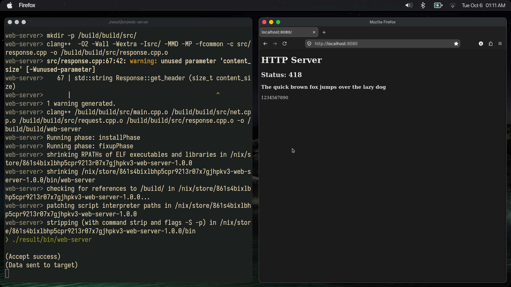

# An uncomplete HTTP server from scratch
- Using C++ and Linux/Posix network sockets.

## Usage:
### Build:
- Use `nix build --print-build-logs` if you want to use nix.
- Otherwise, install the dependencies and follow the commands in flake.nix.

### Running:
- If you used nix build, the output binary is `./result/bin/web-server`

### Testing:
- For async requests: `ab -c 100 -n 100 http://localhost:8080/`

## Todo:
- [x] Read a GET request from client
- [x] Send a GET response to client
- [x] Organise code and allow for more flexibility
- [x] First pass at multithreading
  - [ ] Second pass to fix any problems
- [x] Support other data types (especially images)
- [ ] Add unit testing
- [ ] Pen test and fill any holes
- [ ] Support other http methods
- [ ] Use io_uring and optimise
